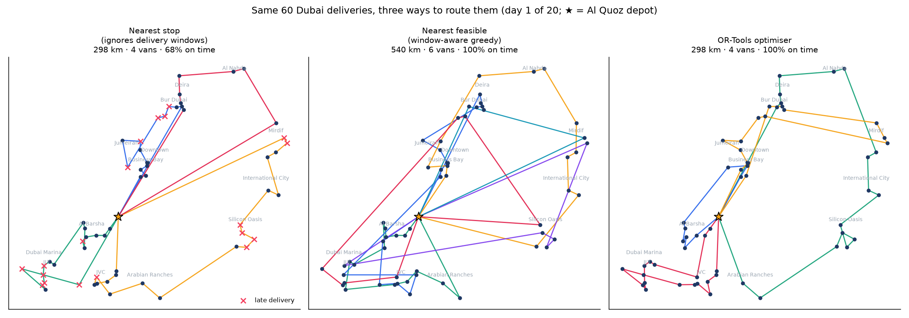
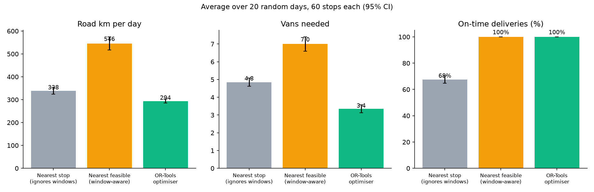
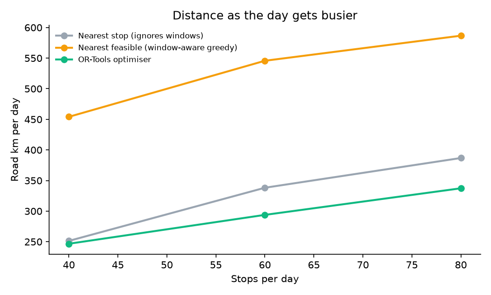

# Dubai Last-Mile Route Optimiser

Vehicle routing for a Dubai delivery station: **60 delivery stops a day, van capacity, 2-hour customer delivery windows and an end-of-shift deadline**. It compares two common "dispatcher" approaches with a mathematical optimiser (Google OR-Tools) over **20 random days**, scoring every plan with the same independent evaluator.



## Key results (20 days, 60 stops each, mean ± 95% CI)

| Method | Vans | Road km | Driving hours | On time | Van fill |
|---|---|---|---|---|---|
| Nearest stop (ignores windows) | 4.85 ± 0.23 | 338 ± 15 | 10.6 | **68%** | 61% |
| Nearest feasible (window-aware greedy) | 7.00 ± 0.40 | 546 ± 29 | 17.1 | 100% | 43% |
| **OR-Tools optimiser** | **3.35 ± 0.23** | **294 ± 9** | **9.2** | **100%** | **89%** |

- vs the **nearest-stop dispatcher**: **1.5 fewer vans per day** on average, every delivery on time instead of 68%, and **12% fewer km** on average (it varies by day: from 14% more to 23% fewer, because the optimiser must respect windows the dispatcher ignores).
- vs the **window-aware greedy dispatcher**: **46% fewer km** (37-53% across days) and **less than half the vans**.
- The optimiser needs 10 seconds per day.



## The problem

A van leaves the Al Quoz delivery station at 09:00. Customers are spread across 14 Dubai neighbourhoods (Marina to Mirdif). 60% of them chose a 2-hour delivery window (09-11, 11-13, 13-15, 15-17); the rest accept any time. Each van carries 40 parcels and must be back by 17:30. **Goal:** deliver everything on time, with as few vans and kilometres as possible.

This is the **capacitated vehicle routing problem with time windows (CVRPTW)**, the core planning problem of every last-mile operation.

## The three methods

1. **Nearest stop:** fill one van at a time and always drive to the closest customer next (capacity and shift respected, windows ignored). What happens when drivers pick their own order.
2. **Nearest feasible:** the same, but only choosing customers whose window can still be met. On time, but greedy.
3. **OR-Tools optimiser:** models the whole day at once and minimises distance plus a fixed cost per van, with hard constraints on capacity, windows and shift end. It starts from a cheapest-arc solution and improves it with guided local search for 10 seconds.

## How the results are kept honest

- **One evaluator for all methods** (`src/evaluate.py`): it drives every plan minute by minute (waits if early, records lateness, checks capacity and return time).
- The optimiser rounds times **up** to whole minutes, so its plans stay on time when driven with exact times.
- 20 different random days; savings are compared **paired by day**.
- 11 tests: known Dubai distance check, matrix symmetry, evaluator by hand, every stop served exactly once, capacity and shift respected for all methods, window-aware methods always on time, optimiser beats the greedy baseline.

## Sensitivity: does it hold when the day gets busier?



| Stops per day | Vans (nearest stop → optimiser) | On time (nearest stop → optimiser) |
|---|---|---|
| 40 | 3.2 → 2.4 | 64% → 100% |
| 60 | 4.85 → 3.35 | 68% → 100% |
| 80 | 6.0 → 4.4 | 63% → 100% |

## Assumptions (all in `src/config.py`)

- **Synthetic customers:** neighbourhood centres are approximate public coordinates; customers are placed randomly around them (no real customer data).
- Road distance = straight-line distance × 1.35 (typical urban circuity); average speed 32 km/h including traffic.
- Service time 4 min per stop + 0.5 min per parcel; 1-3 parcels per stop; van capacity 40.
- One van costs as much as 30 km of driving in the optimiser's objective.

## Limitations and next steps

- Real road distances and live traffic (e.g. OSRM or a maps API) instead of straight-line × circuity.
- Different travel times by hour (Sheikh Zayed Road at 8 am vs 2 pm).
- Failed deliveries and re-attempts, driver breaks, multiple depots.

## Run it

```bash
python3 -m venv .venv && source .venv/bin/activate
pip install -r requirements.txt
./run_all.sh
```

## Project structure

```
src/config.py           all assumptions
src/instance.py         synthetic Dubai delivery days, distance and time matrices
src/heuristics.py       the two dispatcher baselines
src/optimise.py         OR-Tools CVRPTW model
src/evaluate.py         independent evaluator used for every method
src/run_experiments.py  20 days + sensitivity, confidence intervals
src/charts.py           maps and charts
tests/test_routing.py   11 tests
```

## Tech

Python · Google OR-Tools · NumPy · pandas · matplotlib · pytest

Author: Abderrahmane Messaoudi, Industrial Engineering & Engineering Management, University of Sharjah · [LinkedIn](https://www.linkedin.com/in/abderrahmane-messaoudi-984161273/)
